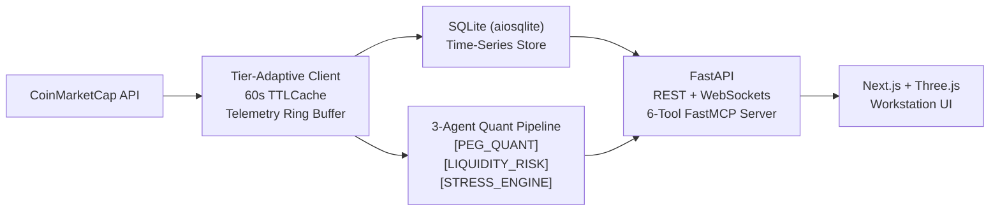

# Obsidian Terminal

**Autonomous Institutional RWA Intelligence, 3D Risk Topology & Portfolio Stress-Testing Workstation**

[](LICENSE)

> **Live Demo** — [https://youtu.be/OSybd3yz0pQ](https://youtu.be/OSybd3yz0pQ)

---

## Architecture



---

## Core Views

| Key | View | Description |
|-----|------|-------------|
| `1` | **MATRIX** | Real-time RWA token matrix with live price feeds, peg deviation, and risk scores |
| `2` | **3D LATTICE** | Three.js risk topology — interactive 3D scatter of volatility, liquidity, and peg stability |
| `3` | **STRESS & CONSOLE** | Deterministic stress-test scenarios with agent console output and portfolio impact |
| `4` | **CMC PROOF** | Raw CoinMarketCap API response viewer with quota telemetry and cache diagnostics |

---

## Quantitative Methodology

- **Gold-Backed Peg Tracking** — `PAXG`/`XAUT` spread measured in basis points against spot gold, triggering `GOLD_DEPEG_SHOCK` scenario when spread exceeds threshold.
- **Treasury NAV Benchmark** — `USDY` accrued yield benchmarked against on-chain Treasury NAV for real-time yield deviation scoring.
- **Floating RWA Dispersion** — Cross-sectional volatility across `ONDO`, `CFG`, `POLYX`, `OM` quantifies sector-wide risk contagion.
- **3-Factor Risk Weights** — Composite risk score: **40%** peg stability · **35%** liquidity depth · **25%** volatility regime.

---

## CoinMarketCap API Endpoints

| Endpoint | Purpose |
|----------|---------|
| `/v1/cryptocurrency/quotes/latest` | Real-time price, volume, market cap, and percent change data |
| `/v1/cryptocurrency/info` | Token metadata, description, URLs, and platform contract addresses |
| `/v1/key/info` | API key quota usage, rate limits, and plan tier diagnostics |

---

## Local Quickstart

### Backend

```bash
cd backend
python -m venv .venv
source .venv/bin/activate   # Windows: .venv\Scripts\activate
pip install -r requirements.txt
cp .env.example .env        # Add your CMC_API_KEY
uvicorn main:app --reload --port 8000
```

### Frontend

```bash
cd frontend
npm install
cp .env.example .env.local
npm run dev                 # http://localhost:3000
```

---

## Keyboard Shortcuts

| Key | Action |
|-----|--------|
| `1` – `4` | Switch between core views |
| `J` / `K` | Navigate rows / tokens in active view |
| `Cmd/Ctrl + K` | Open command palette |
| `R` | Force refresh data from CoinMarketCap API |

---

## License

[MIT](LICENSE) — Copyright (c) 2026 FOKRUL ISLAM
