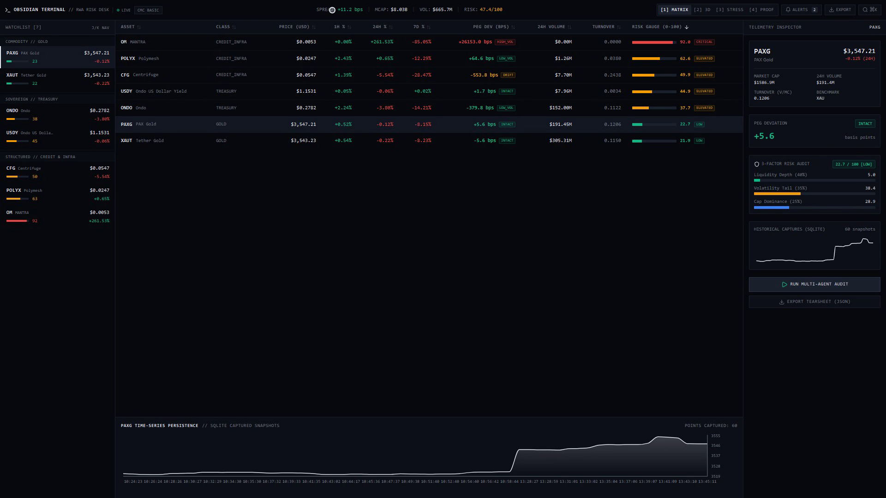
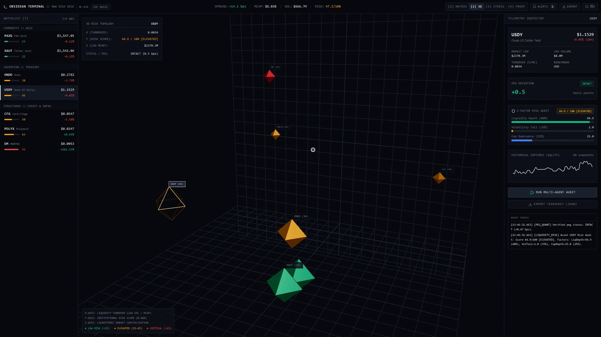
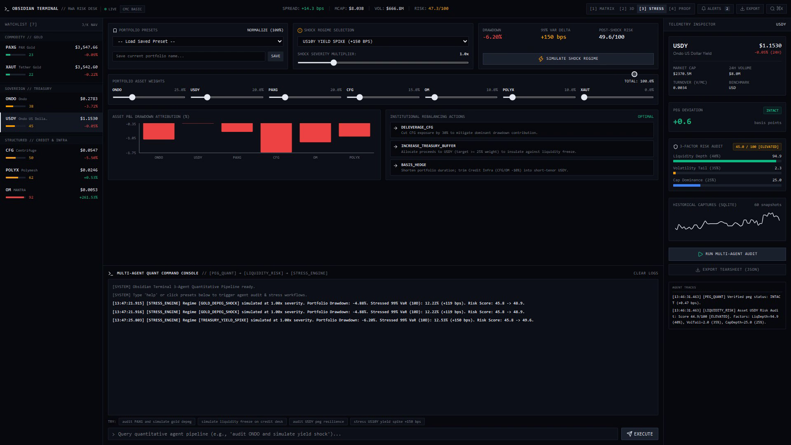
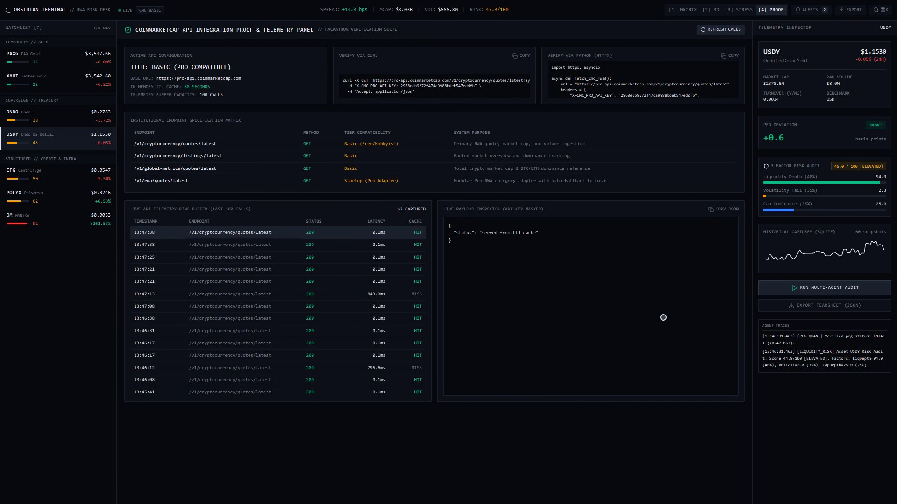
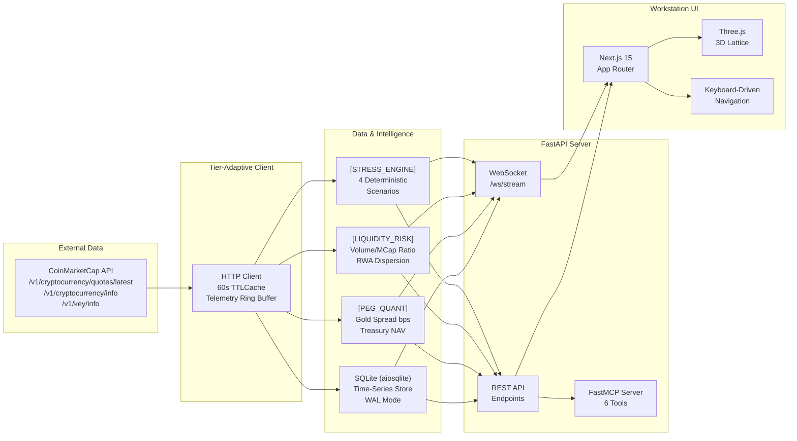

<div align="center">

# 🔮 OBSIDIAN TERMINAL

### Autonomous Institutional RWA Intelligence, 3D Risk Topology & Portfolio Stress-Testing Workstation

[](https://python.org)
[](https://fastapi.tiangolo.com)
[](https://nextjs.org)
[](https://threejs.org)
[](https://github.com/jlowin/fastmcp)
[](https://coinmarketcap.com/api/)
[](LICENSE)
[](https://github.com/fokrulanthro16-eng/obsidian-rwa-terminal/actions)

*A quantitative workstation for real-time RWA token analysis, 3D risk topology visualization, and deterministic portfolio stress testing — powered by a 3-agent quant pipeline, CoinMarketCap market data, and a 6-tool MCP server.*

---

</div>

## 🎬 Live Demo

<div align="center">
<a href="https://youtu.be/OSybd3yz0pQ">
  
</a>

**[▶ Watch the Full Demo on YouTube](https://youtu.be/OSybd3yz0pQ)**

</div>

---

## 📸 Visual Showcase

<table>
<tr>
<td align="center" width="50%">

<br /><strong>[1] MATRIX</strong> — Real-time RWA token matrix
</td>
<td align="center" width="50%">

<br /><strong>[2] 3D LATTICE</strong> — Three.js risk topology
</td>
</tr>
<tr>
<td align="center" width="50%">

<br /><strong>[3] STRESS & CONSOLE</strong> — Deterministic stress testing
</td>
<td align="center" width="50%">

<br /><strong>[4] CMC PROOF</strong> — Raw API response viewer
</td>
</tr>
</table>

---

## 🏗️ System Architecture



---

## 🧠 3-Agent Quantitative Pipeline

| Agent | Function | Methodology |
|-------|----------|-------------|
| **`[PEG_QUANT]`** | Peg Stability Scoring | Computes `PAXG`/`XAUT` spread in basis points against spot gold reference; tracks `USDY` accrued yield deviation against on-chain Treasury NAV benchmark; outputs per-token peg stability score (0.0–1.0) |
| **`[LIQUIDITY_RISK]`** | Liquidity Depth Analysis | Evaluates 24h volume-to-market-cap ratio; flags tokens below configurable liquidity threshold; cross-references dispersion across `ONDO`, `CFG`, `POLYX`, `OM`; outputs per-token liquidity depth score (0.0–1.0) |
| **`[STRESS_ENGINE]`** | Stress-Test Simulation | Executes deterministic scenario simulations; computes portfolio-level drawdown and recovery estimates; outputs scenario impact matrix and per-token stress scores |

### 3-Factor Composite Risk Formula

$$R_{\text{composite}} = 0.40 \times S_{\text{peg}} + 0.35 \times S_{\text{liquidity}} + 0.25 \times (1 - V_{\text{normalized}})$$

| Factor | Weight | Description |
|--------|--------|-------------|
| Peg Stability | **40%** | Gold-backed spread tracking + Treasury NAV deviation |
| Liquidity Depth | **35%** | Volume/market-cap ratio + cross-sectional RWA dispersion |
| Volatility Regime | **25%** | Inverse normalized volatility (lower volatility → higher score) |

---

## 💥 Deterministic Stress-Test Scenarios

| Scenario ID | Description | Shock Parameters |
|-------------|-------------|-----------------|
| `GOLD_DEPEG_SHOCK` | Gold-backed tokens lose peg — PAXG/XAUT deviate ≥500 bps from spot gold | `spread_bps: 500`, `recovery_hours: 72` |
| `TREASURY_YIELD_SPIKE` | Sudden Treasury yield spike erodes USDY NAV premium | `yield_delta_bps: 150`, `nav_impact: -2.5%` |
| `LIQUIDITY_FREEZE` | Sector-wide liquidity evaporation across all RWA tokens | `volume_multiplier: 0.05`, `duration_hours: 48` |
| `CUSTOM_BLACK_SWAN` | User-defined multi-factor shock combining arbitrary parameters | `factors: [user-defined]`, `severity: 1.0–10.0` |

> All scenarios are **deterministic** — identical inputs produce identical outputs for full reproducibility. The engine applies shocks to the latest snapshot, recomputes all three agent scores, and emits a delta report.

---

## 🔧 6 FastMCP Tools

| # | Tool | Description |
|---|------|-------------|
| 1 | `get_rwa_matrix` | Returns the latest RWA token matrix with prices, risk scores, and peg status |
| 2 | `get_risk_topology` | Returns 3D coordinates (volatility, liquidity, peg) for the Three.js lattice |
| 3 | `run_stress_test` | Executes a named scenario and returns portfolio impact analysis |
| 4 | `get_price_history` | Queries SQLite time-series for a symbol within a date range |
| 5 | `get_api_telemetry` | Returns CoinMarketCap API quota, cache stats, and ring buffer state |
| 6 | `get_token_metadata` | Returns token metadata, contract addresses, and reference URLs |

---

## 🌐 REST & WebSocket Endpoints

### REST API

| Method | Endpoint | Description |
|--------|----------|-------------|
| `GET` | `/api/matrix` | Full RWA token matrix with latest prices and risk scores |
| `GET` | `/api/topology` | 3D risk topology coordinates for lattice visualization |
| `POST` | `/api/stress` | Execute a stress-test scenario with custom parameters |
| `GET` | `/api/history/{symbol}` | Historical price time-series for a specific token |
| `GET` | `/api/telemetry` | API quota usage, cache statistics, and diagnostics |
| `GET` | `/api/metadata/{symbol}` | Token metadata and contract addresses |
| `GET` | `/health` | Service health check |

### WebSocket Stream

| Endpoint | Message Types |
|----------|--------------|
| `ws://localhost:8000/ws/stream` | `price_update`, `risk_update`, `stress_result`, `telemetry` |

```jsonc
// Server → Client message envelope
{
  "type": "price_update" | "risk_update" | "stress_result" | "telemetry",
  "timestamp": "2026-11-21T14:35:00.000Z",
  "payload": { /* type-specific data */ }
}
```

---

## 📡 CoinMarketCap API Endpoints

| Endpoint | Purpose |
|----------|---------|
| `/v1/cryptocurrency/quotes/latest` | Real-time price, volume, market cap, and percent change data |
| `/v1/cryptocurrency/info` | Token metadata, description, URLs, and platform contract addresses |
| `/v1/key/info` | API key quota usage, rate limits, and plan tier diagnostics |

---

## 📁 Repository Structure

```
obsidian-rwa-terminal/
├── backend/
│   ├── agents/
│   │   ├── peg_quant.py          # [PEG_QUANT] agent
│   │   ├── liquidity_risk.py     # [LIQUIDITY_RISK] agent
│   │   └── stress_macro.py       # [STRESS_ENGINE] agent
│   ├── tests/
│   │   └── test_quant_engine.py  # Pytest suite
│   ├── main.py                   # FastAPI app + WebSocket hub
│   ├── cmc_client.py             # Tier-adaptive CoinMarketCap client
│   ├── database.py               # aiosqlite schema & queries
│   ├── mcp_server.py             # 6-tool FastMCP server
│   ├── alert_engine.py           # Threshold alert system
│   ├── ws_hub.py                 # WebSocket connection manager
│   ├── requirements.txt
│   ├── Dockerfile
│   └── .env.example
├── frontend/
│   ├── src/
│   │   ├── app/                  # Next.js 15 app router
│   │   │   ├── page.tsx          # Main workstation page
│   │   │   ├── layout.tsx        # Root layout
│   │   │   └── globals.css       # Global styles
│   │   ├── components/
│   │   │   ├── views/
│   │   │   │   ├── MatrixView.tsx        # [1] MATRIX view
│   │   │   │   ├── RiskLattice3D.tsx     # [2] 3D LATTICE view
│   │   │   │   ├── RiskLatticeCanvas.tsx # Three.js canvas renderer
│   │   │   │   ├── StressConsoleView.tsx # [3] STRESS & CONSOLE view
│   │   │   │   └── CMCProofView.tsx      # [4] CMC PROOF view
│   │   │   ├── CommandPalette.tsx        # Cmd/Ctrl+K command palette
│   │   │   ├── CommandBar.tsx            # Bottom command bar
│   │   │   ├── AlertDrawer.tsx           # Alert notification drawer
│   │   │   ├── TelemetryInspector.tsx    # API telemetry panel
│   │   │   └── WatchlistDock.tsx         # Token watchlist sidebar
│   │   ├── lib/
│   │   │   └── api.ts            # WebSocket client & API hooks
│   │   └── types/
│   │       └── index.ts          # TypeScript type definitions
│   ├── package.json
│   ├── tsconfig.json
│   ├── next.config.ts
│   ├── Dockerfile
│   └── .env.example
├── docs/
│   └── assets/                   # UI screenshots
├── .github/
│   └── workflows/
│       └── ci.yml                # GitHub Actions CI pipeline
├── docker-compose.yml
├── ARCHITECTURE.md
├── LICENSE
├── README.md
└── .gitignore
```

---

## 🐳 Docker Quickstart

```bash
# Clone the repository
git clone https://github.com/fokrulanthro16-eng/obsidian-rwa-terminal.git
cd obsidian-rwa-terminal

# Configure environment
cp backend/.env.example backend/.env
cp frontend/.env.example frontend/.env.local
# Edit backend/.env → add your CMC_API_KEY

# Launch everything
docker compose up --build
```

Open **http://localhost:3000** — the full workstation is live.

---

## 💻 Local Development

### Backend

```bash
cd backend
python -m venv .venv
source .venv/bin/activate   # Windows: .venv\Scripts\activate
pip install -r requirements.txt
cp .env.example .env        # Add your CMC_API_KEY
uvicorn main:app --reload --port 8000
```

### Frontend

```bash
cd frontend
npm install
cp .env.example .env.local
npm run dev                 # http://localhost:3000
```

---

## ⌨️ Keyboard Shortcuts

| Key | Action |
|-----|--------|
| `1` – `4` | Switch between core views (Matrix, 3D Lattice, Stress, CMC Proof) |
| `J` / `K` | Navigate rows / tokens in active view |
| `Cmd/Ctrl + K` | Open command palette |
| `R` | Force refresh data from CoinMarketCap API |

---

## 📄 License

[MIT](LICENSE) — Copyright (c) 2026 FOKRUL ISLAM
